# 7. 机械臂正逆运动学构建指南

本章说明如何从示教器、用户手册与 `robot.xml` 收集数据，建立与艾利特 EC616（模板中亦写作 EA66）控制器一致的正运动学（FK）与逆运动学（IK）。几何以示教器连杆参数为第一优先级，不以 URDF 关节 `origin` 作为尺度真值。

## 7.1 DH 参数

DH 参数可在示教器「参数设置」或用户手册中获得。手册表给出各关节 \(\theta,a,d,\alpha\) 的角色；示教器页给出当前机的 **d1～d8**（mm）及法兰轴向示意。标量长度若与手册四舍五入值不一致，以示教器与可复验的 joint–pose 对为准。

<p align="center">
  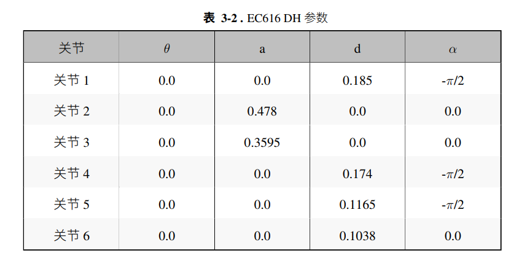
</p>
<p align="center"><em>图：用户手册 DH 参数表（拓扑与符号）。</em></p>

<p align="center">
  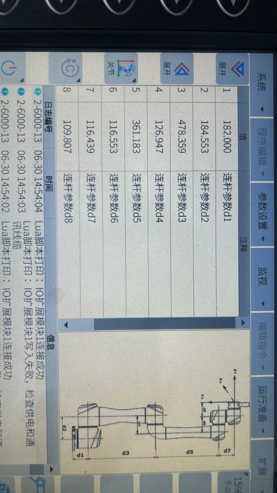
</p>
<p align="center"><em>图：示教器连杆参数 d1～d8 及法兰坐标系示意。</em></p>

> **G26562（本包，2026-10-28）**：本机 MDH 已入库 `示教器信息/MDH.jpg`，并写入 `profiles/elite_cs66.yaml`。相对本机 16 组 joint–pose，FK 位置残差约 **0.001–0.005 mm**，姿态（SciPy intrinsic `xyz`）约 **0.001°**；IK（seed=示教关节）最大关节误差范数约 **0.007°**。

示教器当前摘录 — 本机 MDH 诊断六标量（单位 mm，由 `mdh` 导出，非 EC 的 d1～d8 页）：

| 参数 | 数值 (mm) | 注释 |
|------|-----------|------|
| ℓ1 (d1) | 162.458 | MDH d1 |
| ℓ2 (|a3|) | 427.807 | MDH \|a3\| |
| ℓ3 (|a4|) | 391.197 | MDH \|a4\| |
| ℓ4 (d4) | 147.834 | MDH d4 |
| ℓ5 (d5) | 95.8973 | MDH d5 |
| ℓ6 (d6) | 94.6230 | MDH d6 |

MDH 表（m / rad，列 J1…J6）写入 `profiles/elite_cs66.yaml` → `mdh.a_m` / `d_m` / `alpha_rad`。用法：CS 系列以 MDH 驱动 FK；勿把 EC 的八个 d1～d8 逐项抄进六元向量。

## 7.2 安装信息

安装方式与基座旋转可在示教器中读取。地面安装且 Rot(Z1, V)、Rot(Xb, Q1) 均为 0° 时，模型基座可与水平安装的标准基坐标一致；侧装或倾转需按示教器实际值左乘安装矩阵。

<p align="center">
  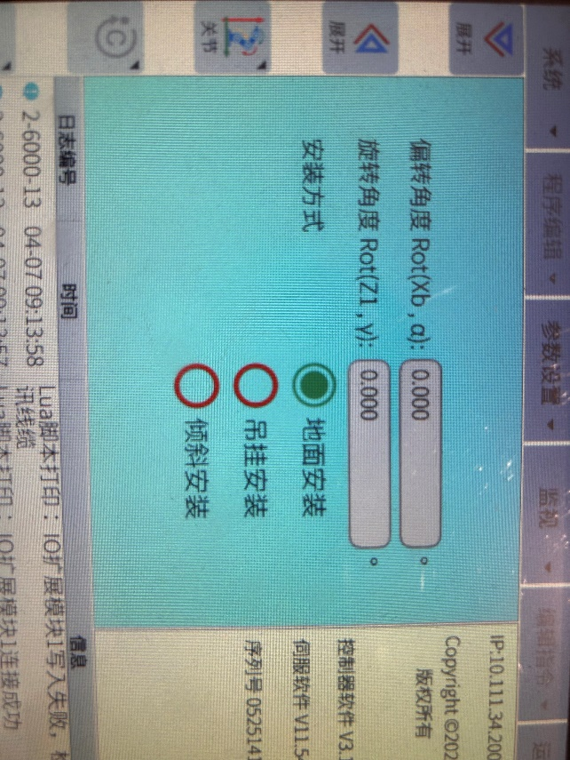
</p>
<p align="center"><em>图：示教器安装信息。</em></p>

当前摘录（G26562 / 2026-10-27 示教器）：**地面安装**；倾斜 = 0.000°；绕 Z 轴旋转 = 0.000°（CS UI）。FK 使用 `R_install = I`。TCP 当前激活 = `[0,0,0,0,0,0]`（法兰）。

## 7.3 各关节位置示意图

示教器示意图用于核对各轴在臂上的位置与测量段，不直接作为数值真值。

<p align="center">
  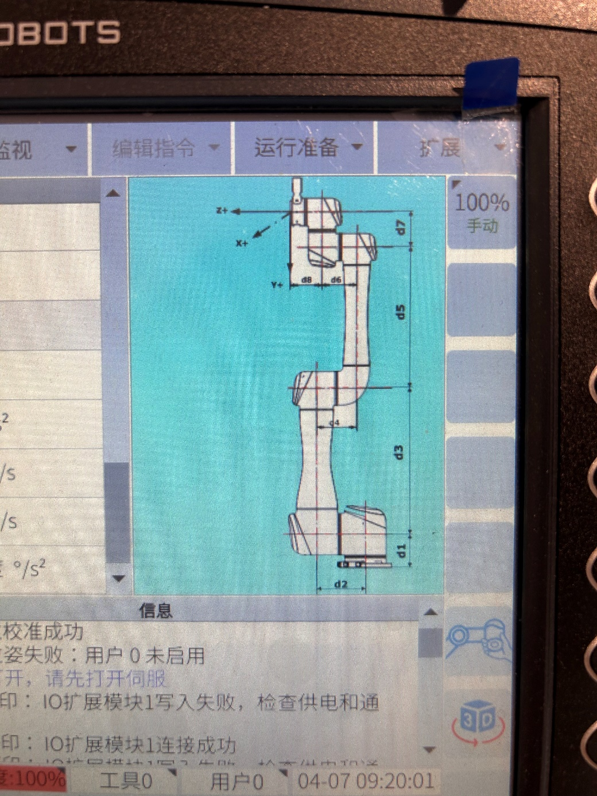
</p>
<p align="center"><em>图：示教器各关节位置示意图。</em></p>

## 7.4 关节坐标系示意

手册中的关节坐标系图用于理解各关节 \(z_i\) 轴向、\(\alpha_i\) 以及 \(a_i/d_i\) 分配，与偏置腕 \(-\pi/2\) 扭转一致；不参与数值自动读取。

<p align="center">
  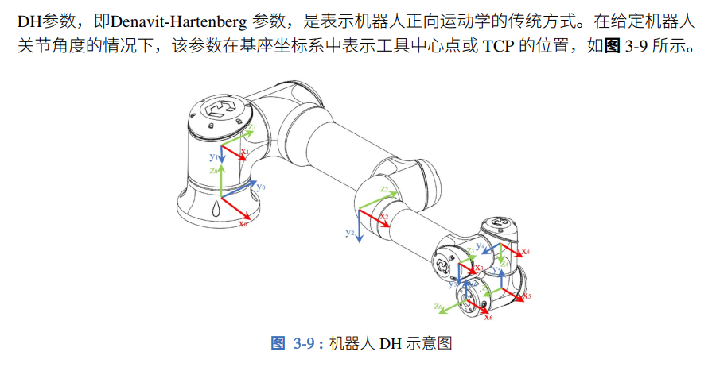
</p>
<p align="center"><em>图：关节坐标系示意。</em></p>

## 7.5 轴限位及加速度限制

软极限与速度、加速度以示教器为准，优先于 `robot.xml` 与 URDF 中的占位 `limit`。下列截图为示教器原页。

<p align="center">
  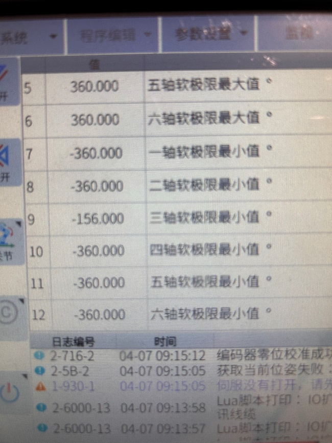
</p>
<p align="center"><em>图：轴软限制（页 1）。</em></p>

<p align="center">
  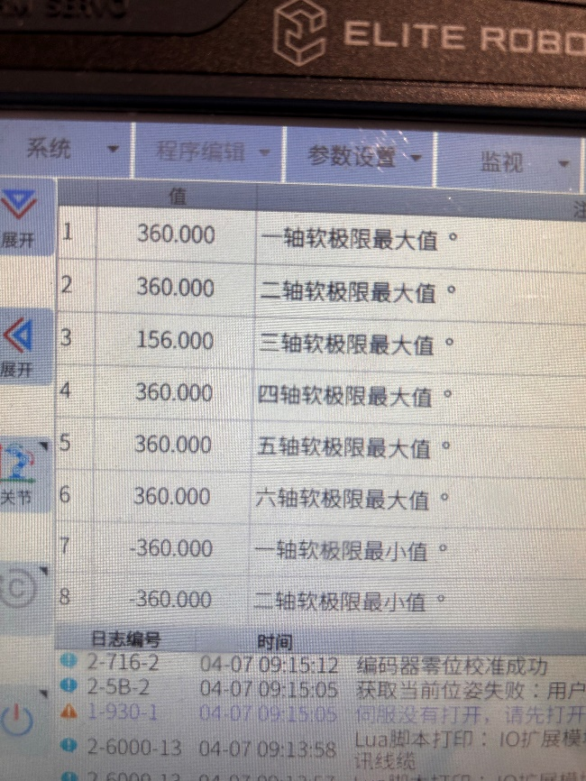
</p>
<p align="center"><em>图：轴软限制（页 2）。</em></p>

<p align="center">
  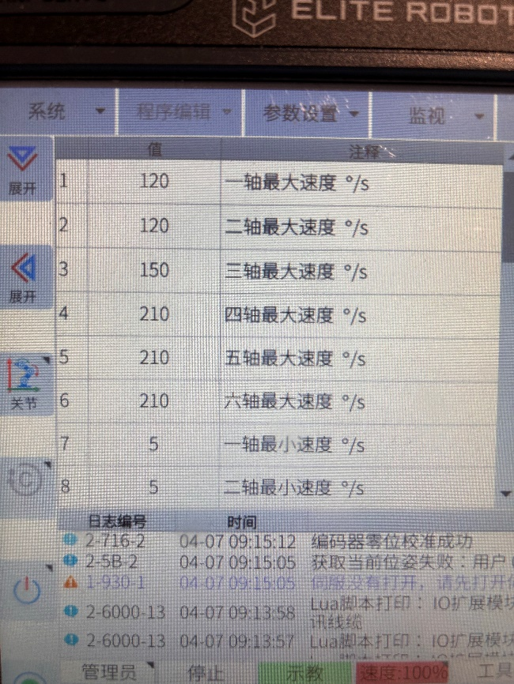
</p>
<p align="center"><em>图：轴速度与加速度限制（页 1）。</em></p>

<p align="center">
  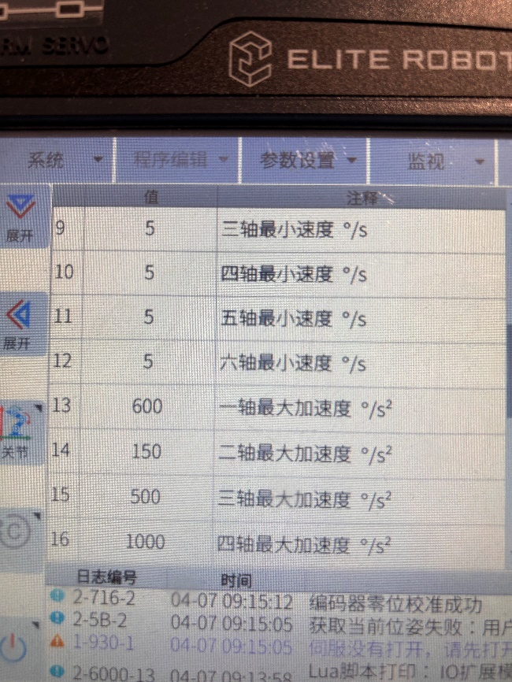
</p>
<p align="center"><em>图：轴速度与加速度限制（页 2）。</em></p>

<p align="center">
  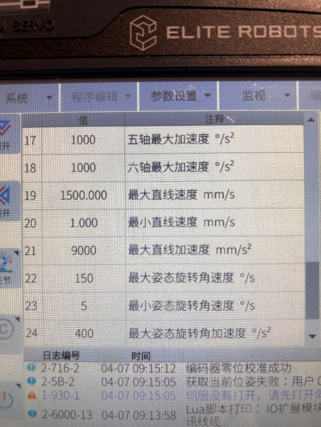
</p>
<p align="center"><em>图：轴速度与加速度限制（页 3）。</em></p>

摘录见第 7.8 节运动参数与软极限表。**G26562（2026-10-27）**：六轴位置范围正常模式均为 \(\pm 363^\circ\)；最大速度正常模式 J1/J2 = 164 °/s，J3 = 210 °/s，J4–J6 = 290 °/s（见 `微信图片_20261027204214`）。URDF 限位多为占位，勿当作真值。

## 7.6 joint–pose 对

在示教器手动模式、精度 100% 下同时记录关节角与基座系末端位姿（必要时通过摇操修改 TCP 后读取）。成对数据用于验收 FK：用几何与关节映射算出位姿，与表示教对比。须与厂商文档统一 RX、RY、RZ 的顺序与定式；若示教器报告 TCP 而模型建到法兰，比较前须乘上 TCP 相对法兰的固定变换。

<p align="center">
  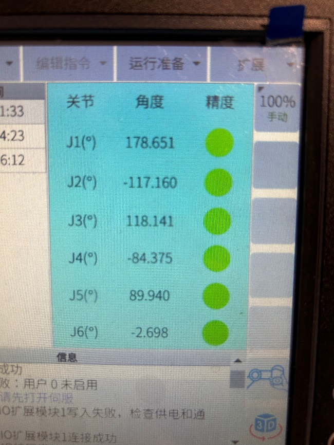
</p>
<p align="center"><em>图：示教器关节角（时刻 1）。</em></p>

<p align="center">
  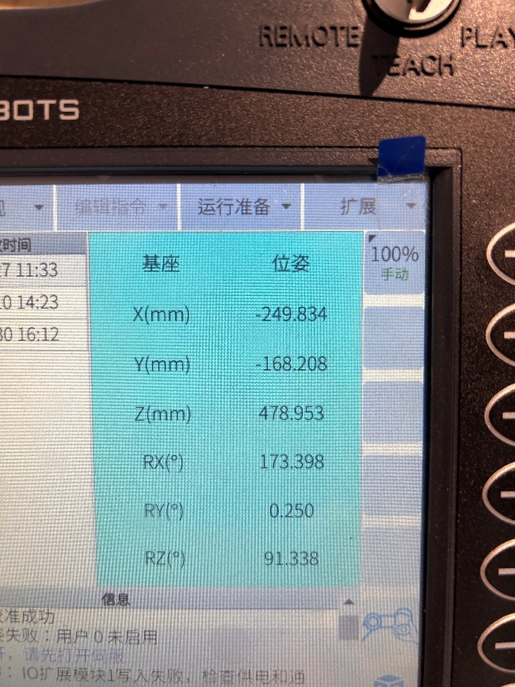
</p>
<p align="center"><em>图：示教器关节角（时刻 2）。</em></p>

<p align="center">
  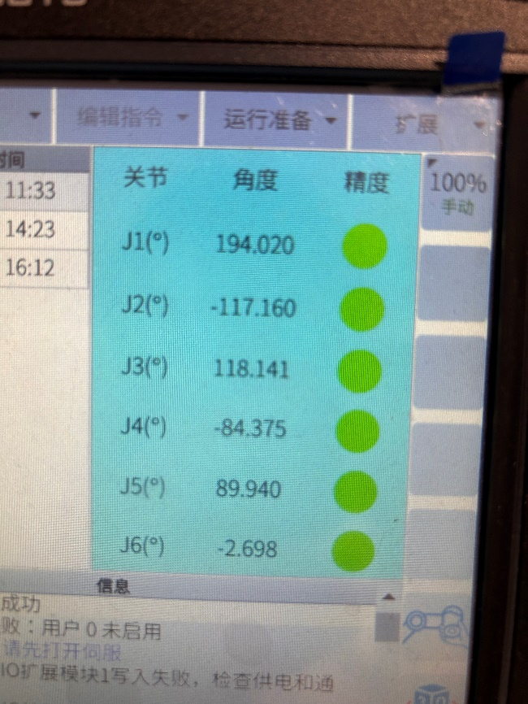
</p>
<p align="center"><em>图：示教器关节角（时刻 3）。</em></p>

<p align="center">
  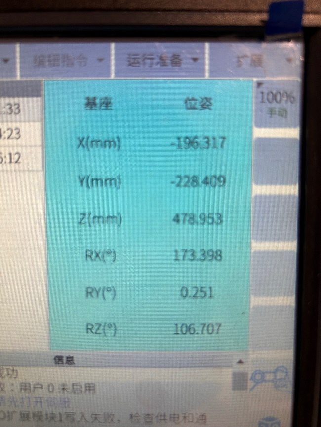
</p>
<p align="center"><em>图：示教器末端位姿（时刻 1）。</em></p>

<p align="center">
  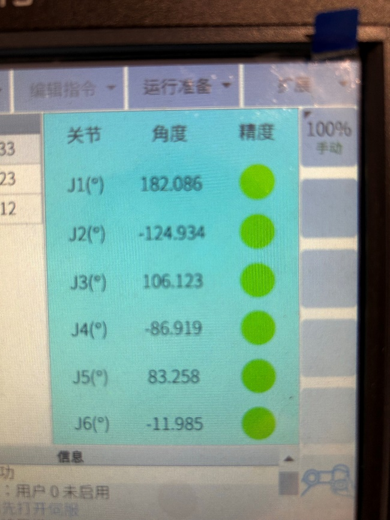
</p>
<p align="center"><em>图：示教器末端位姿（时刻 2）。</em></p>

<p align="center">
  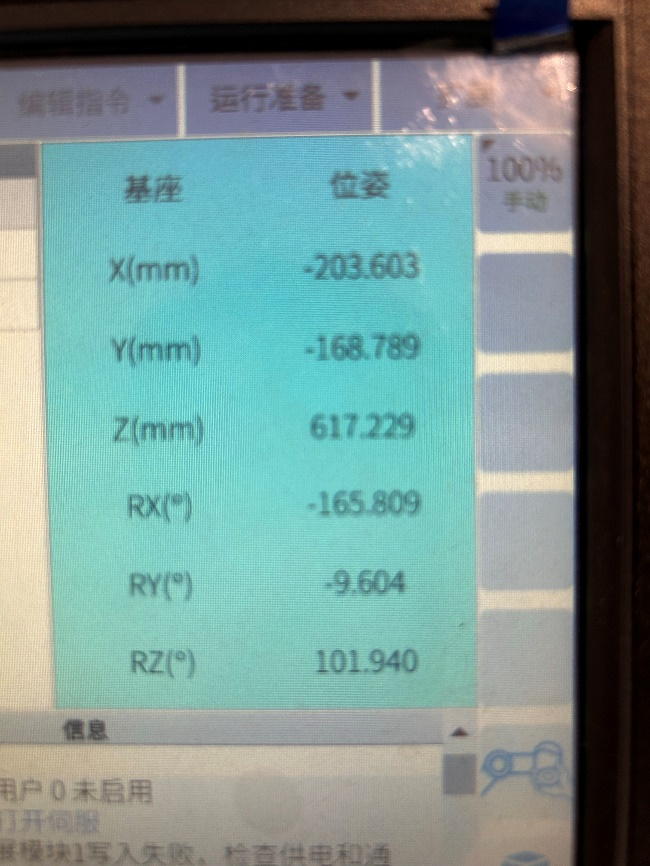
</p>
<p align="center"><em>图：示教器末端位姿（时刻 3）。</em></p>

数值表见第 7.8 节。

## 7.7 robot.xml 模板

厂商模板提供 `LinkLength_*`、`JointOffset_*`、`JointDirection_*`、`BaseCsX` / `BaseCsZ`、`ManipulatorType` 以及速度加速度等。型号字段在模板中可能仍为 EA66，机型确认为 EC616 时勿与 CS66 混用。XML 中的关节限位、速度常与示教器不一致，**限位与运动边界以示教器为准**。下列为当前模板全文，供对照，不作为唯一真值。

```xml
<?xml version="1.0" encoding="UTF-8"?>
<RobotTemplate>
	<!--可视化模型文件-->
	<VisualModels>
	    <!--模型名称，用于校验。理论上与文件夹同名。不匹配表示出错-->
		<Item keyname="ModelName" name="模型名称" valuetype="string" value="EA66" />
		<!--数据类型, 1 - 模型数据类型 2 - 参数数据类型-->
		<Item keyname="DataType"	name="数据类型" 	valuetype="int"	value="1" />
		<!--缩略图-->
		<Item keyname="ThumbnailName" name="缩略图名称" valuetype="string" value="robot.png" />
		<!--模型数量与Model_xx对应-->
		<Item keyname="ModelNumber"    name="模型数量" valuetype="int" value="7" />
		<Item keyname="ModelScaleUnit" name="模型长度单位" valuetype="int" value="1" help="1-Millimeter, 2-Meter"/>
		<Item keyname="Model_1"   name="第一个模型文件名称" valuetype="string"  	value="0.stl" />
		<Item keyname="Model_2"   name="第二个模型文件名称" valuetype="string"  	value="1.stl" />
		<Item keyname="Model_3"   name="第三个模型文件名称" valuetype="string"  	value="2.stl" />
		<Item keyname="Model_4"   name="第四个模型文件名称" valuetype="string"  	value="3.stl" />
		<Item keyname="Model_5"   name="第五个模型文件名称" valuetype="string"  	value="4.stl" />
		<Item keyname="Model_6"   name="第六个模型文件名称" valuetype="string"  	value="5.stl" />
		<Item keyname="Model_7"   name="第七个模型文件名称" valuetype="string"  	value="6.stl" />
	</VisualModels>
	<!--机械臂参数-->
	<Manipulator>
		<Item keyname="ManipulatorModel" name="机械臂型号" 		valuetype="string" 	value="EA66"/>
		<Item keyname="ManipulatorType"  name="机械臂类型" 		valuetype="int" 	value="1" help="1-六轴偏置腕机器人, 2-六轴球形腕机器人, 3-SCARA机器人, 4-4轴码垛机器人, "/>
		<Item keyname="DefaultRotFormat" name="默认旋转格式"   valuetype="int" 	value="3" help="1-固定XYZ欧拉角, 2-四元数, 3-旋转向量, 4-随动XYZ欧拉角, 5-随动ZYX欧拉角, 6-随动ZYZ欧拉角, 7-随动ZXZ欧拉角, 8-固定ZYX欧拉角"/>
		<!--连杆长度。最多8根连杆，浮点数-->
		<Item keyname="LinkLength_1"	 name="第一个连杆长度"	valuetype="float"	value="182" help="单位-mm"/>
		<Item keyname="LinkLength_2"	 name="第二个连杆长度" valuetype="float"	value="478.359" />
		<Item keyname="LinkLength_3" 	 name="第三个连杆长度" valuetype="float"	value="361.183" />
		<Item keyname="LinkLength_4"	 name="第四个连杆长度" valuetype="float" 	value="174.159" />
		<Item keyname="LinkLength_5"	 name="第五个连杆长度" valuetype="float"	value="116.439" />
		<Item keyname="LinkLength_6"	 name="第六个连杆长度" valuetype="float"	value="109.807" />
		<Item keyname="LinkLength_7"	 name="第七个连杆长度" valuetype="float"	value="0" />
		<Item keyname="LinkLength_8"	 name="第八个连杆长度" valuetype="float"	value="0" />
		<!--零位偏置。浮点数-->
		<Item keyname="JointOffset_1"	 name="J1零位偏置" 		valuetype="float"	value="0.0" />
		<Item keyname="JointOffset_2"	 name="J2零位偏置" 		valuetype="float"	value="-90" />
		<Item keyname="JointOffset_3"	 name="J3零位偏置" 		valuetype="float"	value="0.0" />
		<Item keyname="JointOffset_4"	 name="J4零位偏置" 		valuetype="float"	value="-90" />
		<Item keyname="JointOffset_5"	 name="J5零位偏置" 		valuetype="float"	value="180" />
		<Item keyname="JointOffset_6"	 name="J6零位偏置" 		valuetype="float"	value="0.0" />
		<!--轴向，整数-->
		<Item keyname="JointDirection_1" name="一轴方向" 		valuetype="int"		value="1" />
		<Item keyname="JointDirection_2" name="二轴方向" 		valuetype="int"		value="1" />
		<Item keyname="JointDirection_3" name="三轴方向" 		valuetype="int"		value="1" />
		<Item keyname="JointDirection_4" name="四轴方向" 		valuetype="int"		value="1" />
		<Item keyname="JointDirection_5" name="五轴方向" 		valuetype="int"		value="1" />
		<Item keyname="JointDirection_6" name="六轴方向" 		valuetype="int"		value="1" />
		<!--轴下限，浮点数-->
		<Item keyname="JointMin_1" 		 name="J1下限" 			valuetype="float"	value="-180" />
		<Item keyname="JointMin_2"		 name="J2下限" 			valuetype="float"	value="-180" />
		<Item keyname="JointMin_3"		 name="J3下限" 			valuetype="float"	value="-180" />
		<Item keyname="JointMin_4"		 name="J4下限" 			valuetype="float"	value="-360" />
		<Item keyname="JointMin_5"		 name="J5下限" 			valuetype="float"	value="-180" />
		<Item keyname="JointMin_6"		 name="J6下限" 			valuetype="float"	value="-360" />
		<!--轴上限，浮点数-->
		<Item keyname="JointMax_1"		 name="J1上限" 			valuetype="float"	value="180" />
		<Item keyname="JointMax_2"		 name="J2上限" 			valuetype="float"	value="180" />
		<Item keyname="JointMax_3"		 name="J3上限" 			valuetype="float"	value="180" />
		<Item keyname="JointMax_4"		 name="J4上限" 			valuetype="float"	value="360" />
		<Item keyname="JointMax_5"		 name="J5上限" 			valuetype="float"	value="180" />
		<Item keyname="JointMax_6"		 name="J6上限" 			valuetype="float"	value="360" />
		<!--机械臂连杆凸包长方形的宽，浮点数-->
		<Item keyname="LinkConvexHullWidth_1" name="一轴凸包宽" valuetype="float"	value="100" />
		<Item keyname="LinkConvexHullWidth_2" name="二轴凸包宽" valuetype="float"	value="100" />
		<Item keyname="LinkConvexHullWidth_3" name="三轴凸包宽" valuetype="float"	value="100" />
		<Item keyname="LinkConvexHullWidth_4" name="四轴凸包宽" valuetype="float"	value="100" />
		<Item keyname="LinkConvexHullWidth_5" name="五轴凸包宽" valuetype="float"	value="100" />
		<Item keyname="LinkConvexHullWidth_6" name="六轴凸包宽" valuetype="float"	value="100" />
		<Item keyname="LinkConvexHullWidth_7" name="七轴凸包宽" valuetype="float"	value="100" />
		<Item keyname="LinkConvexHullWidth_8" name="八轴凸包宽" valuetype="float"	value="100" />
		<!--机械臂连杆凸包长方形的长，浮点数-->
		<Item keyname="LinkConvexHullLength_1" name="一轴凸包长" valuetype="float"	value="100" />
		<Item keyname="LinkConvexHullLength_2" name="二轴凸包长" valuetype="float"	value="100" />
		<Item keyname="LinkConvexHullLength_3" name="三轴凸包长" valuetype="float"	value="100" />
		<Item keyname="LinkConvexHullLength_4" name="四轴凸包长" valuetype="float"	value="100" />
		<Item keyname="LinkConvexHullLength_5" name="五轴凸包长" valuetype="float"	value="100" />
		<Item keyname="LinkConvexHullLength_6" name="六轴凸包长" valuetype="float"	value="100" />
		<Item keyname="LinkConvexHullLength_7" name="七轴凸包长" valuetype="float"	value="100" />
		<Item keyname="LinkConvexHullLength_8" name="八轴凸包长" valuetype="float"	value="100" />
		<!--基坐标系X轴向，整数。 1-向上；2-向下；3-向左；4-向右；5-向前；6-向右-->
		<Item keyname="BaseCsX"				name="基坐标系X轴向" valuetype="int"	value="6" help="1-向上；2-向下；3-向左；4-向右；5-向前；6-向右" />
		<!--基坐标系Z轴向，整数-->
		<Item keyname="BaseCsZ" 			name="基坐标系Z轴向" valuetype="int"	value="1" help="1-向上；2-向下；3-向左；4-向右；5-向前；6-向右" />
		<!--工具坐标系X轴向，整数-->
		<Item keyname="ToolCsX" 			name="工具坐标系X轴向" valuetype="int"	value="6" help="1-向上；2-向下；3-向左；4-向右；5-向前；6-向上" />
		<!--工具坐标系Z轴向，整数-->
		<Item keyname="ToolCsZ"			 	name="工具坐标系Z轴向" valuetype="int"	value="4" help="1-向上；2-向下；3-向左；4-向右；5-向前；6-向右" />
		<!--最大角速度，整数。度/秒，放大1000倍-->
		<Item keyname="JointVelocityMax_1" 	name="J1最大角速度" 	valuetype="int"	value="120" />
		<Item keyname="JointVelocityMax_2" 	name="J2最大角速度" 	valuetype="int"	value="120" />
		<Item keyname="JointVelocityMax_3" 	name="J3最大角速度" 	valuetype="int"	value="180" />
		<Item keyname="JointVelocityMax_4" 	name="J4最大角速度" 	valuetype="int"	value="180" />
		<Item keyname="JointVelocityMax_5" 	name="J5最大角速度" 	valuetype="int"	value="180" />
		<Item keyname="JointVelocityMax_6" 	name="J6最大角速度" 	valuetype="int"	value="180" />
		<!--最大角加速度，整数。度/秒平方   放大1000倍-->
		<Item keyname="JointAccelerationMax_1" name="J1最大角加速度" valuetype="int"	value="480" />
		<Item keyname="JointAccelerationMax_2" name="J2最大角加速度" valuetype="int"	value="480" />
		<Item keyname="JointAccelerationMax_3" name="J3最大角加速度" valuetype="int"	value="720" />
		<Item keyname="JointAccelerationMax_4" name="J4最大角加速度" valuetype="int"	value="720" />
		<Item keyname="JointAccelerationMax_5" name="J5最大角加速度" valuetype="int"	value="720" />
		<Item keyname="JointAccelerationMax_6" name="J6最大角加速度" valuetype="int"	value="720" />
		<Item keyname="AxisNum" name="轴数" valuetype="int"	value="6" />
		<Item keyname="MaxLoad" name="负载" valuetype="int"	value="10" />
		<Item keyname="WorkRange" name="最大工作范围" valuetype="int"	value="1300" />
		<Item keyname="DINum" name="数字量输入" valuetype="int"	value="18" />
		<Item keyname="DONum" name="数字量输出" valuetype="int"	value="18" />
	</Manipulator>
</RobotTemplate>
```

## 7.8 示教器信息清单

### 安装方式

- 安装方式：地面安装
- Rot(Z1, V) = 0.000°
- Rot(Xb, Q1) = 0.000°

### 关节角度（手动模式，精度 100%）

| 时刻 | J1 (°) | J2 (°) | J3 (°) | J4 (°) | J5 (°) | J6 (°) |
|------|--------|--------|--------|--------|--------|--------|
| 1 | 178.651 | -117.160 | 118.141 | -84.375 | 89.940 | -2.698 |
| 2 | 194.020 | -117.160 | 118.141 | -84.375 | 89.940 | -2.698 |
| 3 | 182.086 | -124.934 | 106.123 | -86.919 | 83.258 | -11.985 |

### 末端位姿（基座坐标系）

| 时刻 | X (mm) | Y (mm) | Z (mm) | RX (°) | RY (°) | RZ (°) |
|------|--------|--------|--------|--------|--------|--------|
| 1 | -249.834 | -168.208 | 478.953 | 173.398 | 0.250 | 91.338 |
| 2 | -196.317 | -228.409 | 478.953 | 173.398 | 0.251 | 106.707 |
| 3 | -203.603 | -168.789 | 617.229 | -165.809 | -9.604 | 101.940 |

### 各轴速度限制

| 轴 | 最大速度 (°/s) | 最小速度 (°/s) |
|----|----------------|----------------|
| J1 | 120 | 5 |
| J2 | 120 | 5 |
| J3 | 150 | 5 |
| J4 | 210 | 5 |
| J5 | 210 | 5 |
| J6 | 210 | 5 |

### 各轴最大加速度

- J1：600 °/s²
- J2：150 °/s²
- J3：500 °/s²
- J4：1000 °/s²
- J5：1000 °/s²
- J6：1000 °/s²

### 直线与姿态运动参数

- 最大直线速度：1500 mm/s
- 最小直线速度：1 mm/s
- 最大直线加速度：9000 mm/s²
- 最大姿态旋转角速度：150 °/s
- 最小姿态旋转角速度：5 °/s
- 最大姿态旋转角加速度：400 °/s²

### 软极限（关节运动范围）— G26562 示教器 2026-10-27

| 轴 | 最大值 (°) | 最小值 (°) |
|----|------------|------------|
| J1 | 363 | -363 |
| J2 | 363 | -363 |
| J3 | 363 | -363 |
| J4 | 363 | -363 |
| J5 | 363 | -363 |
| J6 | 363 | -363 |

### 各轴最大速度（正常模式，°/s）— 同页

| 轴 | 最大速度 (°/s) |
|----|----------------|
| J1 | 164 |
| J2 | 164 |
| J3 | 210 |
| J4 | 290 |
| J5 | 290 |
| J6 | 290 |

## 7.8.1 现场采集空白表（供打印填写）

以下空白表对应本章建 FK/IK **必须或强烈推荐**采集的示教器信息，供现场人员手填或电子填报后交回建模。填写约定：

1. 几何二选一优先：有 **MDH 参数页**（CS 系列常见）填表 B；有 **连杆 d1～d8 页**（EC 系列常见）填表 A。两者皆有时两表都填，并以 joint–pose 验收为准。
2. 安装：EC 示教器填 Rot(Z1, V) / Rot(Xb, Q1)；CS 示教器填「倾斜 / 绕 Z 轴旋转」及安装预设（地面/墙面/天花板）。**基座系 joint–pose 对表时**，若 FK 与示教位姿已闭合，勿把「仅重力/安全用」的倾斜再乘进运动学 `R_install`（见 CS66 处理说明）。
3. joint–pose：手动模式、速度 **100%**；坐标系选 **基座**；记录激活 TCP 名称及其相对法兰的偏置；姿态格式写明（如 RPY[°]）。建议至少 **8** 组、覆盖多轴组合。
4. 软限与速度加速度以示教器为准，优先于 URDF / `robot.xml`。

### 表 0 — 机型与记录信息

| 项目 | 填写 |
|------|------|
| 品牌 / 型号 |  |
| 机器人序列号 |  |
| 控制器型号与版本 |  |
| 示教器 / 控制器 IP |  |
| 采集日期 |  |
| 采集人 |  |
| 任务/配置名（示教器） |  |
| 备注 |  |

### 表 A — 连杆参数 d1～d8（EC 类示教器，单位 mm）

| 参数 | 数值 (mm) | 注释（示教器原文） |
|------|-----------|-------------------|
| d1 |  |  |
| d2 |  |  |
| d3 |  |  |
| d4 |  |  |
| d5 |  |  |
| d6 |  |  |
| d7 |  |  |
| d8 |  |  |

法兰坐标系约定（据示意图勾选或文字说明）：Z+ ______；X+ ______。

### 表 B — MDH 参数（CS 类示教器，单位：a/d 为 m，α 为 rad）

| 参数 | J1 | J2 | J3 | J4 | J5 | J6 |
|------|----|----|----|----|----|-----|
| a | 0.0000000 | 0.0000000 | -0.4278070 | -0.3911970 | 0.0000000 | 0.0000000 |
| d | 0.1624580 | 0.0000000 | 0.0000000 | 0.1478340 | 0.0958973 | 0.0946230 |
| alpha | 0.0000000 | 1.5708000 | 0.0000000 | 0.0000000 | 1.5708000 | -1.5708000 |

截图文件名 / 页路径：`示教器信息/MDH.jpg`（G26562，2026-10-28 提取）。

### 表 C — 安装信息

| 项目 | 填写 |
|------|------|
| 安装预设（地面 / 墙面 / 天花板 / 其它） |  |
| Rot(Z1, V) 或「绕 Z 轴旋转」(°) |  |
| Rot(Xb, Q1) 或「倾斜」(°) |  |
| 是否用于重力/安全（勾选：是 / 否） |  |
| 是否已按基座系 joint–pose 验证 FK（勾选：是 / 否） |  |
| 备注（侧装、倾转、世界系对齐需求等） |  |

### 表 D — TCP 与姿态约定

| 项目 | 填写 |
|------|------|
| 激活 TCP 名称 |  |
| TCP 相对法兰 X,Y,Z (mm) |  |
| TCP 相对法兰 RX,RY,RZ (°) |  |
| 末端位姿报告对象（法兰 / TCP） |  |
| 姿态格式（如 RPY[°] / 旋转矢量） |  |
| 欧拉顺序（如固定 XYZ / 随动 ZYX 等） |  |

### 表 E — 软极限（关节运动范围，单位 °）

| 轴 | 最大值 (°) | 最小值 (°) | 来源页（正常/缩减等） |
|----|------------|------------|----------------------|
| J1 |  |  |  |
| J2 |  |  |  |
| J3 |  |  |  |
| J4 |  |  |  |
| J5 |  |  |  |
| J6 |  |  |  |

### 表 F — 各轴速度限制（单位 °/s）

| 轴 | 最大速度 (°/s) | 最小速度 (°/s) |
|----|----------------|----------------|
| J1 |  |  |
| J2 |  |  |
| J3 |  |  |
| J4 |  |  |
| J5 |  |  |
| J6 |  |  |

### 表 G — 各轴最大加速度（单位 °/s²）

| 轴 | 最大加速度 (°/s²) |
|----|-------------------|
| J1 |  |
| J2 |  |
| J3 |  |
| J4 |  |
| J5 |  |
| J6 |  |

### 表 H — 直线与姿态运动参数

| 项目 | 数值 | 单位 |
|------|------|------|
| 最大直线速度 |  | mm/s |
| 最小直线速度 |  | mm/s |
| 最大直线加速度 |  | mm/s² |
| 最大姿态旋转角速度 |  | °/s |
| 最小姿态旋转角速度 |  | °/s |
| 最大姿态旋转角加速度 |  | °/s² |

### 表 I — joint–pose 对（手动模式，速度 100%，基座坐标系）

每行一组：先记关节角，再记同姿态下的末端位姿。空行不够可续表。

**关节角 (°)**

| 时刻 | J1 | J2 | J3 | J4 | J5 | J6 |
|------|----|----|----|----|----|-----|
| 1 |  |  |  |  |  |  |
| 2 |  |  |  |  |  |  |
| 3 |  |  |  |  |  |  |
| 4 |  |  |  |  |  |  |
| 5 |  |  |  |  |  |  |
| 6 |  |  |  |  |  |  |
| 7 |  |  |  |  |  |  |
| 8 |  |  |  |  |  |  |

**末端位姿（与上表同行时刻对应）**

| 时刻 | X (mm) | Y (mm) | Z (mm) | RX (°) | RY (°) | RZ (°) |
|------|--------|--------|--------|--------|--------|--------|
| 1 |  |  |  |  |  |  |
| 2 |  |  |  |  |  |  |
| 3 |  |  |  |  |  |  |
| 4 |  |  |  |  |  |  |
| 5 |  |  |  |  |  |  |
| 6 |  |  |  |  |  |  |
| 7 |  |  |  |  |  |  |
| 8 |  |  |  |  |  |  |

截图文件名（关节 / 位姿成对）：____________。

## 7.9 正运动学最小完备物料

优先级约定：

1. 第一优先级：示教器信息与「机械臂参数」实拍（当前控制器与机构标定）。
2. 最低优先级：`EC616 urdf.urdf`（SolidWorks 导出，仅作 CAD 参考；与第一优先级不一致时以示教器为准）。

### 几何主数据（建 FK 必需）

来源：示教器连杆参数 d1～d8，单位 mm（见 7.1 表与图）。法兰处坐标系示意：Z+ 沿法兰外法向，X+ 向上（以图为准）。据此构造 DH；不再以 URDF 的 joint `origin` 作为主尺度。若需与 URDF 并存，只能二选一驱动 FK，默认链路以 d1～d8 为准。

### 基座与实机对齐（必需）

来源：第 7.2、7.8 节安装信息。基座坐标系下单轴无额外旋转时，可与水平安装的标准基坐标一致。

### 校验用成对数据（强烈推荐）

来源：第 7.6、7.8 节关节角与基座系位姿。用途：用几何加关节映射算出位姿并与表对比。

### 关节软限与运动边界

来源：第 7.5、7.8 节（优先于 `robot.xml` / URDF `limit`）。用于规划与 IK 边界，不参与 FK 闭式推导。

### 最低优先级：URDF

用途：网格 visual/collision、ROS 链，或缺少示教器连杆页时的临时几何猜测。与 d1～d8 及示教验证冲突时不采用 URDF 修正主尺度。

### 最小集合

| 用途 | 最小物料 |
|------|----------|
| 写出与 EC616 控制器一致的几何 FK | 机械臂参数图 → d1～d8 + 轴向/法兰约定 |
| 基座与现场一致 | 示教器安装一节 |
| 证明模型对 | 关节角 + 基座系位姿（加 TCP/欧拉约定） |
| 轨迹/可达性检查 | 软限与速度加速度 |
| 可选备用 | URDF（不与主尺度混用为真值） |

仍须在手册中补全、但不影响写出 FK 矩阵的项：RX、RY、RZ 的欧拉顺序与固定/随动轴；末端位姿相对 TCP 还是法兰；工具号非零时的 TCP 标定值。以上影响与示教姿态逐元对比是否闭合。

## 7.10 正逆运动学构造过程

本节说明如何把上述资料推进到代码：资料筛选 → 最小数据清单 → 正运动学 → 逆运动学 → 校验。建模对象为 6 自由度串联链，运动学写到**法兰系**；TCP 与法兰不同时通过齐次变换处理。

### 目标与输出约定

- 位姿输出：`fk_flange` 返回 \(4\times 4\) 齐次矩阵，平移单位为米；`fk_position_mm` 为基座系下毫米位置。
- 关节角输入：默认 IK 与示教对表使用 `machine_deg`（度）。
- 正解闭式链：标准 DH，由 6 个标量长度（mm）映射到 \((\theta_i, d_i, a_i, \alpha_i)\)。
- 逆解：不依赖厂商闭式 IK；使用 SciPy `least_squares` 在 \(\mathbb{R}^6\) 上最小化 6 维位姿残差（位置 + 加权旋转矢量）。

### 资料筛选

| 来源 | 作用 | 筛选原则 |
|------|------|----------|
| `robot.xml`（Manipulator 段） | 连杆长度、零位、方向、基座轴向、类型 | 控制器/模板侧几何与偏置；限位以示教为准 |
| 示教器信息 | 安装、关节角与基座系位姿、软限、速度加速度 | 验收金数据 |
| 手册 DH 表 | 拓扑与符号 | 定结构；标量以 XML + 示教验证为准 |
| 关节坐标系示意 | \(\alpha_i\) 与轴向 | 理解用，不自动读数 |
| 机械臂参数图 | d1～d8 与法兰方向 | 与六段 `link_length_mm` 对照 |
| EC616 URDF | CAD/可视化 | 不作为主尺度真值 |

淘汰或弱化：URDF 占位限位；手册表与 182 mm 对 185 mm 一类差异不单独采信；凸包与障碍不属于运动学方程核心。

### 建立正运动学闭合链（必需）

1. 六连杆长度（mm），填入 DH 行的 \(d_1, a_2, a_3, d_4, d_5, d_6\)。
2. 标准 DH 拓扑（偏置腕，机型固定）：\(d_1\) 且 \(\alpha_1=-\pi/2\)；\(a_2,a_3\) 水平臂；\(d_4,d_5,d_6\) 与 \(\alpha_4=\alpha_5=-\pi/2\)、\(\alpha_6=0\)。
3. 基座相对世界的旋转：由 `BaseCsX`、`BaseCsZ` 得到 \(T_{\mathrm{base}}\) 的旋转（平移现为 0）。
4. 机械臂类型 `ManipulatorType = 1`（六轴偏置腕）。
5. 关节角语义：`machine_deg` 为读数（度）与模型 \(q\) 一致（可再乘 `joint_direction`）；`xml_delta_dir` 为 \((\theta_{\mathrm{读}}-\mathrm{offset})\times\mathrm{dir}\) 再转弧度。

逆运动学与工程使用强烈建议再具备：标定用的关节角与基座系位姿；关节软限位与最大速度/加速度。与示教欧拉对齐时还需要 RX、RY、RZ 定义，以及报告位姿是法兰还是 TCP。

### 正运动学

单关节标准 DH 齐次变换 \(A_i\) 由 \((\theta_i, d_i, a_i, \alpha_i)\) 生成，再链乘：

\[
T_0^6 = T_{\mathrm{base}} \cdot A_1 A_2 \cdots A_6
\]

记六连杆长度为 \((\ell_1,\ldots,\ell_6)\)（mm），换算为米后 DH 表为：

| \(i\) | \(\theta_i\)（常数部分） | \(d_i\) | \(a_i\) | \(\alpha_i\) |
|-------|--------------------------|---------|---------|--------------|
| 1 | \(+q_1\) | \(\ell_1\) | 0 | \(-\pi/2\) |
| 2 | \(+q_2\) | 0 | \(\ell_2\) | 0 |
| 3 | \(+q_3\) | 0 | \(\ell_3\) | 0 |
| 4 | \(+q_4\) | \(\ell_4\) | 0 | \(-\pi/2\) |
| 5 | \(+q_5\) | \(\ell_5\) | 0 | \(-\pi/2\) |
| 6 | \(+q_6\) | \(\ell_6\) | 0 | 0 |

表内常数 \(\theta\) 偏置当前全部为 0；零位由 `joint_offset_deg` 与关节角模式在进入 \(q_i\) 时处理。

基座：

\[
T_{\mathrm{base}} = \begin{bmatrix} R_{\mathrm{xml}} R_{\mathrm{install}} & 0 \\ 0 & 1 \end{bmatrix}
\]

其中 \(R_{\mathrm{install}}\) 由 Rot(Z1, V)、Rot(Xb, Q1) 给出；当前示教摘录为全 0，即单位阵。

对外：`fk_flange` 给出法兰系；`fk_tool` 为 `fk_flange` 右乘 \(T_{\mathrm{flange\_tool}}\)；`fk_position_mm` 给出法兰原点毫米位置。

### 逆运动学

已知期望法兰系 \(T_{\mathrm{des}}\)，求 \(q\) 使

\[
f(q) = T_{\mathrm{base}} A_1(q)\cdots A_6(q) = T_{\mathrm{des}}
\]

目标为 TCP 时，先用 \(T_{\mathrm{tool}}^{-1}\) 把期望位姿变到法兰。残差为位置差（米）加旋转矢量（再乘姿态权重）。用 `least_squares` 最小化；需要边界时用 `trf` 并把关节限制在示教软限内。成功判据看位置与姿态残差是否低于容差，不单独信任求解器 `success` 标志。

局限：6R 最多可有多组解析解，本实现为依赖种子的单解数值 IK；奇异位形可能不收敛。

### 数据流

<p align="center">
  
</p>
<p align="center"><em>图：从资料到 FK/IK 的数据流。</em></p>

### 文档与代码对应（YAML 路径）

当前仓库主路径为 `sensors.cs66_kinematics` 的 YAML profile，不再以 `robot.xml` 解析为运行时真值。概念对应关系如下。

| 概念 | 位置 |
|------|------|
| DH 单步与表 | `dh.py`：`standard_dh_link`、`dh_table_from_link_lengths_m` |
| FK 链 | `fk.py`：`fk_flange` |
| IK | `ik.py`：`ik_flange` |
| 型号数据 | `profiles/elite_ec616.yaml` |
| 示教软限 | `teach.py` 与 profile 中 `soft_limits_deg` |

若 `link_length_mm`、示教表更新，应重新用 joint–pose 对验收，并视情况修订优先级说明。
